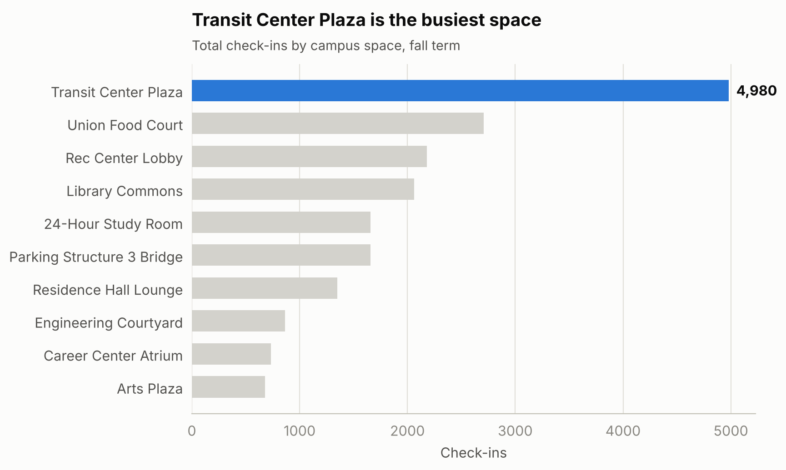

# Campus Wellbeing Outreach Analysis

**Where, when and for whom should a campus peer-wellbeing table be placed?**
An end-to-end data analysis in Python: messy multi-file data → documented cleaning → joins → statistical comparison → charts → a one-page recommendation.

> All data in this repository is **synthetic**. No real students or institutions are represented.

## Recommendation
Place the wellbeing table at **Transit Center Plaza in the evening (5 pm onward)**, with outreach focused on **commuter students**.

| Finding | Evidence |
|---|---|
| Busiest space and time | Transit Center Plaza, evenings: **2,946 check-ins**, nearly double the next busiest slot |
| Who is there | **87%** of its check-ins are by commuter students (vs 8% at the Residence Hall Lounge) |
| Who needs it most | Commuters: **49% high need** vs 40% for residential students (n = 1,231 vs 618), lower belonging (3.21 vs 3.52), lower resource awareness (58% vs 65%), more food/housing concern (29% vs 20%). First-gen students show the same pattern (55% vs 41% high need). |

*High need = stress 4–5 or "often" lonely (analyst-defined).*



## Data
| File | One row per | Notes |
|---|---|---|
| `data/students.csv` | student | level, college, first-gen, commuter status, GPA |
| `data/spaces.csv` | campus space | lookup table |
| `data/checkins.csv` | card check-in (visit) | date, time, purpose |
| `data/feedback.csv` | survey response | belonging, stress, loneliness, support, awareness, basic needs |
| `data/data_dictionary.csv`, `data/feedback_codebook.csv` | field | reference only: define valid values (not joined) |

## Data quality issues found and fixed
- **Duplicates:** exact duplicate students and check-ins removed; students who answered the survey twice kept once.
- **Inconsistent IDs and categories:** lowercase IDs uppercased; spellings standardized (e.g. `Res` → residential, `Y` → yes, `Unsure` → not sure); blanks labeled `missing`, recorded `Unknown` kept separate.
- **Invalid values set to missing, never guessed:** survey ratings outside codebook ranges, GPAs outside 0–4, impossible times (e.g. `25:10`).
- **Unmatched IDs:** check-ins with student or space IDs not in the lookup files excluded, with the reason for every dropped row printed (the counts reconcile).
- **Denominators:** every survey figure reports n, because only ~45% of students responded.

Every step prints a before/after count, and every check is an `assert`, so the notebook stops if anything breaks.

## Repository layout
```
data/                 raw synthetic input files
analysis.ipynb        full workflow, executed, with outputs
outputs/              clean_visits.csv (analysis-ready dataset) + 4 charts
reports/summary.pdf   one-page recommendation (also .docx)
```

## Run it
```bash
pip install -r requirements.txt
jupyter notebook analysis.ipynb      # then Kernel → Restart & Run All
```

## Limitations
- ~45% survey response; respondents may differ from non-respondents.
- Self-reported survey data; results show association, not cause.
- Card swipes may miss some visits; one term of data.

## Tools
Python · pandas · matplotlib · Jupyter
